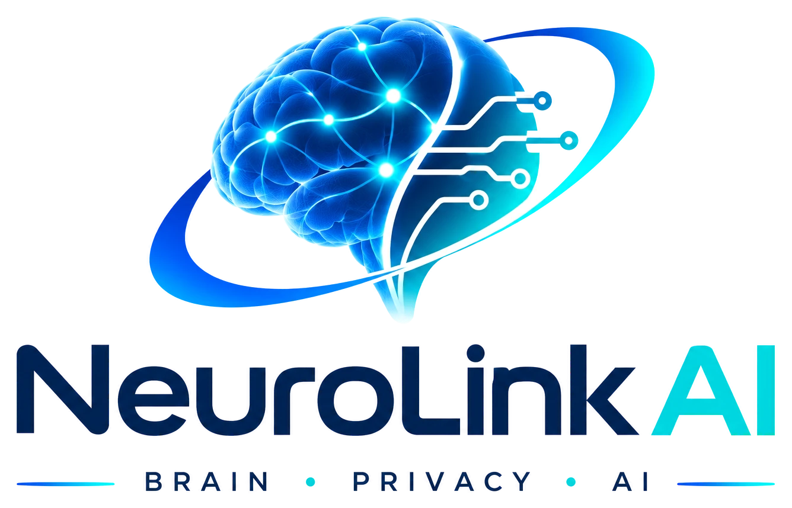
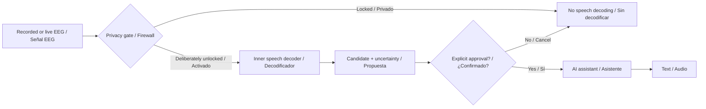

# NeuroLink AI

  <picture>
    <source media="(prefers-color-scheme: dark)" srcset="assets/branding/neurolink-ai-lockup-dark.webp" />
    
  </picture>

<strong>Inner speech → AI · Lenguaje interior → IA</strong>

<a href="https://neurolink-ai-omega.vercel.app"><strong>Visit the website · Visita la web →</strong></a>

**Inner speech → AI, with privacy by design.**  
**Lenguaje interior → IA, con privacidad desde el diseño.**

[Website / Web](https://neurolink-ai-omega.vercel.app) · [English](#english) · [Español](#español) · [Neural Privacy Firewall](docs/technical/neural-privacy-firewall.md) · [Scientific evidence](docs/research/inner-speech-datasets.md) · [Engineering diagrams](diagrams/README.md) · [Brand style guide](assets/branding/STYLE_GUIDE.md)

> **Research / Investigación.** A reliable system for unrestricted, non-invasive inner-speech transcription is **not yet available**. NeuroLink AI has not produced validated neural decoding, human-subject tests or a custom patient-ready electronic device.

## English

**The goal is not to type by mentally selecting letters.** We want to investigate whether the words a person *says to themselves internally* — their voluntary inner speech — can be interpreted by an AI without talking or moving.

The intended interaction is: **voluntary inner speech → neural signal → decoder → preview/consent → AI → response**.

A second, equally important goal is the **Neural Privacy Firewall (NPF)**. Private thoughts must not be sent to the assistant. The proposed design is **locked by default**, opens only following deliberate activation, and requires explicit confirmation before sending a message. A hardware disconnect is a stronger privacy option than relying solely on neural keywords.

Three research phases:

1. **Inner speech → AI (primary):** start with a small, labelled vocabulary and independent EEG evaluation. Open-ended language reconstruction is the long-term scientific goal, not a current capability.
2. **AI → person:** screen and audio first; external tactile codes are optional. Direct neural stimulation is clinical research, outside this independent prototype.
3. **Internet (optional):** external lookups only from explicitly approved messages.

## Español

**Nuestro objetivo no es seleccionar letras con un teclado cerebral.** Queremos investigar cómo interpretar las palabras que nos decimos mentalmente cuando hablamos con nosotros mismos: **la voz interior**, sin pronunciarlas.

La comunicación deseada es: **lenguaje interior voluntario → señales neuronales → decodificador → autorización → IA → respuesta**.

Necesitamos un **Neural Privacy Firewall (NPF)** que distinga pensamiento privado de intención de comunicar. El sistema debe permanecer **bloqueado por defecto**, activarse deliberadamente, permitir cancelar y requerir confirmación antes de transmitir. Un interruptor físico proporciona una garantía de desconexión mayor que confiar únicamente en una palabra clave mental.

Tres fases:

1. **Lenguaje interior → IA (prioridad):** primero clasificar unas pocas palabras imaginadas con EEG real registrado. Reconstruir frases libres es un objetivo de investigación a largo plazo.
2. **IA → persona:** texto y voz inicialmente; tacto externo como investigación opcional. La estimulación neural directa pertenece al ámbito clínico.
3. **Internet (opcional):** consultas mediante la IA solo después de autorización voluntaria.

## System concept / Esquema conceptual

*Architecture only: the offline IS-01 classifier is not connected to this flow; no neural communication gate or custom hardware has been validated.*

## IS-01 pilot / Piloto IS-01

Real EEG, one participant and three held-out sessions: **26.5% pooled balanced accuracy**, 25% chance baseline, permutation **p=0.46**. No evidence of above-chance inner-speech classification; no spontaneous thought decoding or validated intention detection.

EEG real, una persona y tres sesiones separadas: **26,5% balanced accuracy agrupada**, frente al 25% de referencia; **p=0,46**. Sin evidencia de clasificación superior al azar.

[Reproduce / Reproducir](experiments/is01/README.md) · [Results and limitations / Resultados y limitaciones](experiments/is01/reports/pilot-sub01.md). The experiment is separate from the website simulations.

## Start here / Empieza aquí

| Topic / Tema | English | Español |
| --- | --- | --- |
| Vision | [Project](docs/en/simple/01-project.md) | [Visión](docs/simple/01-el-proyecto.md) |
| Inner speech | [Phase 1](docs/en/technical/phase-1-eeg-to-text.md) | [Fase 1](docs/technical/phase-1-eeg-to-text.md) |
| Mental privacy | [Neural firewall](docs/en/technical/neural-privacy-firewall.md) | [Firewall neuronal](docs/technical/neural-privacy-firewall.md) |
| Dataset | [Inner speech evidence](docs/en/research/inner-speech-datasets.md) | [Datasets](docs/research/inner-speech-datasets.md) |
| Hardware | [Electronics (EN)](hardware/en/README.md) | [Electrónica (ES)](hardware/README.md) |
| Diagrams | [Editable diagrams](diagrams/README.md) | [Diagramas](diagrams/README.md) |
| Photos | [Licensed EEG reference photos](assets/real/README.md) | [Fotografías reales](assets/real/README.md) |
| Website | [Bilingual research website (source)](apps/web/README.md) | [Sitio web bilingüe (código)](apps/web/README.md#español) |

**P300 spelling** has been reclassified as a [secondary BCI reference](docs/technical/p300-secondary-baseline.md), **not** the principal interaction design.

## References / Fuentes

- Nieto et al., [*Thinking out loud* (2022)](https://www.nature.com/articles/s41597-022-01147-2); [EEG dataset](https://nemar.org/dataset/on003626): four Spanish imagined-direction words, 10 subjects, 3 conditions, 5640 trials.
- Kunz et al., [*Cell* (2025)](https://doi.org/10.1016/j.cell.2025.06.015): inner-speech decoding and privacy safeguards **with implanted electrodes**, including a mental keyword gate tested in a participant. This **does not** establish reliable wake-word control using scalp EEG.
- [NIH research summary (2025)](https://www.nih.gov/news-events/nih-research-matters/decoding-inner-speech-brain-signals): experimental implanted-device results and private-thought protection.

**Core safeguard / Protección central:** private neural activity is not a command. No involuntary sharing, no raw EEG sent to cloud services by default, and no electrical stimulation or DIY human-contact circuitry.
