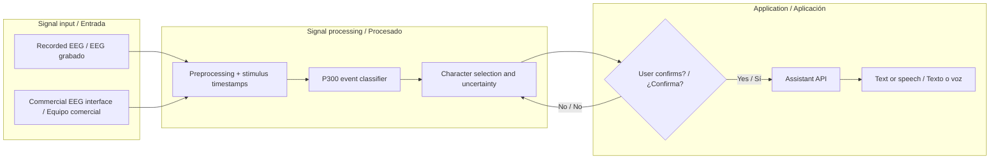

# NeuroLink AI

**Experimental research on brain–computer interfaces, EEG acquisition and AI-assisted communication.**  
**Investigación experimental de interfaces cerebro–ordenador, adquisición EEG y comunicación asistida por IA.**

[English](#english) · [Español](#español) · [Engineering diagrams](diagrams/README.md) · [Real reference photographs](assets/real/README.md)

> **Project status / Estado:** research and design. There is **no validated EEG decoder, human EEG study, custom acquisition board or measured NeuroLink AI result** in this repository yet.

## English

The primary goal is to **compose messages for an AI without typing or speaking**, using voluntary brain signals. Our first method to investigate is EEG-based P300 spelling: selecting characters through a controlled attention task. This is not general-purpose thought reading.

1. **Brain → AI:** record or replay EEG, decode a controlled selection, reconstruct characters and explicitly confirm the message.
2. **AI → person:** receive answers through a screen or speech; explore non-invasive tactile feedback as a separate research track.
3. **Internet, optional:** consult sources through the assistant only after the communication channel is reliable.

**Next experiment:** an offline P300 classification baseline on a documented public dataset, with independent evaluation and an honest distinction between event classification and character spelling.

## Español

La prioridad es **escribir a una IA sin teclado ni voz**, utilizando señales cerebrales voluntarias. Empezaremos estudiando teclados P300: permiten seleccionar letras en una tarea visual controlada, pero no leen cualquier pensamiento.

1. **Cerebro → IA:** adquirir o reproducir EEG, identificar selecciones, reconstruir caracteres y confirmar cada mensaje.
2. **IA → persona:** recibir respuestas mediante pantalla o voz; estudiar después códigos táctiles externos.
3. **Internet, opcional:** consultar fuentes externas cuando la comunicación básica funcione de manera fiable.

**Próximo experimento:** entrenar y evaluar un clasificador P300 con datos públicos, evitando confundir la clasificación de eventos con la escritura de caracteres.

## System architecture / Arquitectura

The software and hardware are independent research workstreams. The figure below is a **conceptual engineering dataflow**, not a measured or validated system.

## Documentation map / Mapa de documentación

| Topic / Tema | English | Español |
| --- | --- | --- |
| Starting point / Introducción | [English guide](docs/en/README.md) | [Guía en español](docs/es/README.md) |
| What we are building / Qué queremos construir | [Project explanation](docs/en/simple/01-project.md) | [Explicación](docs/simple/01-el-proyecto.md) |
| Scientific limits / Límites científicos | [Evidence overview](docs/en/research/state-of-the-science.md) | [Estado de la ciencia](docs/research/state-of-the-science.md) |
| Software architecture / Arquitectura de software | [Architecture (EN)](docs/en/technical/architecture.md) | [Arquitectura (ES)](docs/technical/architecture.md) |
| EEG decoding / Decodificación | [P300 protocol (EN)](docs/en/technical/phase-1-eeg-to-text.md) | [Fase 1 (ES)](docs/technical/phase-1-eeg-to-text.md) |
| Electronics / Electrónica | [Hardware notes (EN)](hardware/en/README.md) | [Hardware (ES)](hardware/README.md) |
| Research roadmap / Hoja de ruta | [Roadmap (EN)](docs/en/research/roadmap.md) | [Roadmap (ES)](docs/research/roadmap.md) |
| Drawings / Diagramas | [Mermaid diagrams](diagrams/README.md) | [Diagramas editables](diagrams/README.md) |
| Photos / Fotos | [Real reference photos](assets/real/README.md) | [Fotos de referencia](assets/real/README.md) |

## Hardware reference / Referencia física

*Real EEG electrode photograph / Fotografía real de un electrodo EEG. George Spilich (Gspilich2), [Wikimedia Commons](https://commons.wikimedia.org/wiki/File:EEG_electrode.jpg), [CC BY-SA 3.0](https://creativecommons.org/licenses/by-sa/3.0/), unmodified / sin modificar. This is **not** hardware developed by NeuroLink AI.*

For reference hardware, consult the original [OpenBCI Cyton documentation](https://docs.openbci.com/Cyton/CytonSpecs/) and [Texas Instruments ADS1299](https://www.ti.com/product/ADS1299). Their technical specifications and images must not be mistaken for devices built or validated by this project.

## Research integrity / Integridad científica

- A `P300 Target/NonTarget` event classifier does **not** automatically constitute a working speller.
- No synthetic data, rendered drawing or language-model completion will be presented as a measured brain response.
- Analog electronics and patient safety come **before** connecting any custom circuit to a person. Experimental boards and simulation code are **not** cleared for human use.
- Direct stimulation of the brain, implants and transfer of complex knowledge are outside independent prototyping.

[Editorial policy](docs/VISUAL_STANDARDS.md) · [Image provenance](assets/SOURCES.md) · [Experimental protocol](docs/technical/research-protocol.md) · [Repository migration plan](docs/REPOSITORY_PLAN.md)
