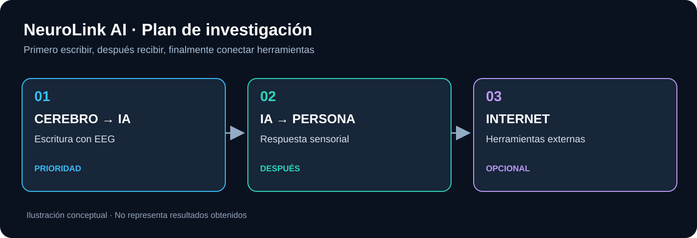
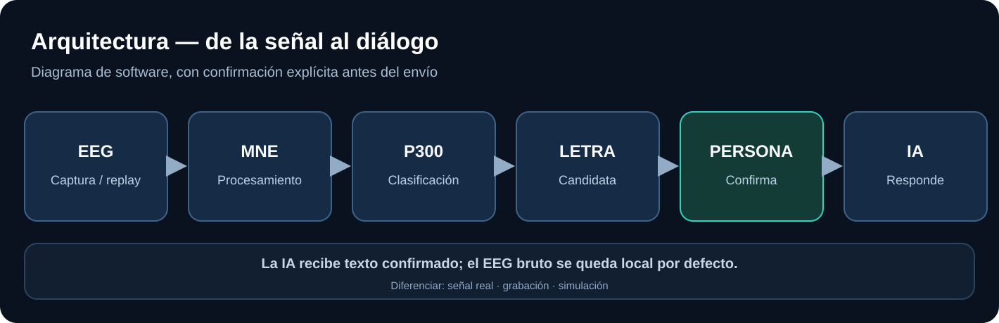

# NeuroLink AI 🧠

**Investigación de interfaces de comunicación bidireccional cerebro–IA.**

La prioridad del proyecto es **escribir a una IA mediante actividad cerebral**, después recibir sus respuestas y, opcionalmente, conectarla a Internet. También investigaremos la electrónica que hace posible registrar estas señales: electrodos, adquisición analógica, digitalización, firmware y, solo si resulta necesario, FPGA/Verilog.

> **Estado actual: diseño e investigación.** No hay todavía un EEG propio, un decodificador validado ni resultados experimentales en este repositorio. Los diagramas e imágenes son **conceptuales**, no una prueba de lectura de pensamientos.



## Elige cómo explorar el proyecto

| Sección | Qué encontrarás |
| --- | --- |
| [**Entender la idea — sin tecnicismos**](docs/simple/README.md) | Explicación sencilla, tres fases, preguntas frecuentes |
| [**Ejemplos con imágenes**](examples/README.md) | Teclado P300, conversación y camino de señales |
| [**Diagramas**](diagrams/README.md) | Esquemas editables Mermaid y SVG |
| [**Documentación técnica**](docs/technical/README.md) | Arquitectura de software, algoritmos, API y seguridad |
| [**Ingeniería electrónica**](hardware/README.md) | Bloques de hardware, ADS1299, firmware, FPGA/Verilog, pruebas y normas |
| [**Investigación científica**](docs/research/README.md) | Evidencia, bibliografía, decisiones y hoja de ruta |
| [**Índice de todo el repositorio**](docs/README.md) | Mapa general y convenciones |

## Objetivos por fase

**01 — Cerebro → IA:** empezar por selección voluntaria de letras con señales EEG P300. No confundirlo con la lectura general de pensamientos.  
**02 — IA → persona:** respuestas en pantalla/voz y estudio posterior de códigos táctiles externos; neuroestimulación directa solo como investigación clínica de literatura.  
**03 — Acceso a Internet:** herramientas bajo confirmación y permisos, una vez funcione la comunicación.



## Nuestro primer MVP

**PoC 0.1:** analizar un conjunto EEG público P300, reproducir métricas fiables, reconstruir caracteres cuando los datos lo permitan y enviar solo texto confirmado a una IA de prueba. El hardware se desarrolla en paralelo, **primero como diagramas, simulación digital y ensayos de banco**, nunca mediante un circuito experimental conectado directamente a una persona.

## Estructura del repositorio

```text
docs/
  simple/       # Lectura accesible para cualquier persona
  technical/    # Procesamiento EEG, interfaces, protocolos, seguridad
  research/     # Publicaciones, decisiones, roadmap y límites científicos
hardware/       # Electrónica analógica, microcontroladores, FPGA y revisión de seguridad
  hdl/          # Verilog/SystemVerilog didáctico para simulación digital
diagrams/       # Fuente editable de los esquemas (Mermaid)
examples/       # Casos ilustrados y explicación paso a paso
assets/
  diagrams/     # Imágenes SVG de arquitectura y fases
  examples/     # Imágenes SVG de ejemplos, diseñadas para este repositorio
```

**Principio de seguridad:** nada de implantes, estimulación cerebral casera, uso humano de protoboards de biopotenciales o exposición de datos cerebrales personales en un repositorio público.

[Ver toda la documentación](docs/README.md) · [Plan de experimentos](docs/technical/research-protocol.md) · [Referencias](docs/research/references.md)
