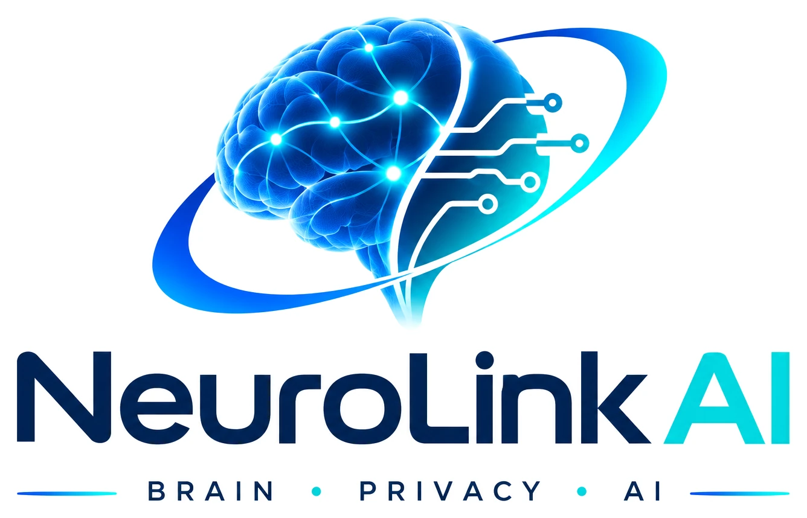

# NeuroLink AI — Brand Style Guide / Guía de estilos

**Official identity · Identidad oficial · 2026-11-11**

## Logo files / Archivos del logotipo

| File / Archivo | Use / Uso |
| --- | --- |
| [`neurolink-ai-lockup.webp`](neurolink-ai-lockup.webp) | Full logo: symbol, wordmark and the line "Brain · Privacy · AI". Primary form. / Logotipo completo; forma principal. |
| [`neurolink-ai-symbol.webp`](neurolink-ai-symbol.webp) | Brain-and-orbit symbol alone, for small or square spaces. / Símbolo solo, para espacios pequeños. |
| [`neurolink-ai-wordmark.webp`](neurolink-ai-wordmark.webp) | "NeuroLink AI" lettering alone. / Solo el nombre. |
| [`icons/`](icons/icon-512.png) | Favicon and app icons: the whole symbol on a white tile — `favicon.ico` (16/32/48), `icon-32.png`, `icon-192.png`, `icon-512.png`, `apple-touch-icon.png` (180). / Iconos: el símbolo completo sobre una pieza blanca. |

These are optimized copies of the supplied artwork: empty margins trimmed to a uniform clear space and the background set to pure white. The artwork itself is not redrawn, recoloured or re-proportioned. Keep symbol and wordmark in the lockup's proportions when they are shown together, and do not place them on coloured backgrounds.

Son copias optimizadas del arte suministrado: márgenes vacíos recortados y fondo en blanco puro. El dibujo no se ha redibujado, recoloreado ni reproporcionado.

[`neurolink-ai-logo.webp`](neurolink-ai-logo.webp) is the **previous logo**, superseded and kept only so that old links keep working. / Es el **logotipo anterior**, sustituido; se conserva solo para no romper enlaces antiguos.

## Colour source / Origen de los colores

The brand colors below were **sampled from the actual pixels of the previous logo's original 1254 × 1254 RGB PNG**. Antialiasing produces slight variations, so representative values are now frozen as the canonical exact HEX tokens. No future design should resample and substitute similar shades.

Los colores se extrajeron de los píxeles reales del logotipo PNG original. Se fijan estos valores HEX como **referencia oficial** para no perderlos en diseños posteriores.

## Palette / Paleta

| Role / Uso | English / Español | HEX | RGB |
| --- | --- | --- | --- |
| Main text, headings / Texto y títulos | Deep navy / Azul marino | **`#001E55`** | 0, 30, 85 |
| Buttons, links / Botones y enlaces | Electric blue / Azul eléctrico | **`#004FF2`** | 0, 79, 242 |
| Decorative accents / Acentos | Cyan / Cian eléctrico | **`#00F0E5`** | 0, 240, 229 |
| Main background / Fondo principal | White / Blanco | **`#FFFFFF`** | 255, 255, 255 |

The closest dominant sampled pixels were #001E55 (navy), #004EF2 with nearby #004FF2 (blue), and #00F0E5 (cyan). The official blue token **#004FF2** is the representative rounded value selected for consistency.

## Design rules / Reglas

- **White background / Fondo blanco:** #FFFFFF is always the primary canvas.
- **Text and outlines / Texto y líneas:** #001E55.
- **Links and primary controls / Enlaces y controles:** #004FF2.
- **Cyan details only / Cian solo para detalles:** #00F0E5 should not be used as body text on white.
- Keep engineering diagrams sober, precise and editable; avoid fake laboratory imagery and decorative gradients.
- Keep diagrams, examples and hardware references visually coherent without recoloring experimental evidence.
- Do not imply a software-only illustration or brand asset is scientific proof.
- Use typography with clear hierarchy and adequate spacing, without excessive visual effects.

Approximate contrast against white: navy **15.95:1**, blue **6.18:1**, cyan **1.44:1**. The cyan accent is **not accessible for small text on white**.

## Reusable design tokens

- [CSS custom properties](tokens.css)
- [Machine-readable JSON](tokens.json)

**Note on the current logo.** In the current wordmark the navy measures about `#002558` and the cyan of "AI" about `#01D7DF`; the symbol uses blue-to-cyan gradients. The canonical tokens above have **not** been changed: they remain the palette for interfaces and documents until the project decides to retune them.

**Nota sobre el logotipo actual.** En el nombre actual el azul marino mide aproximadamente `#002558` y el cian de «AI» aproximadamente `#01D7DF`. Los tokens canónicos **no** se han modificado.

Source: first-party artwork supplied for the project. Use the exact tokens above even if compression changes nearby pixel colors.

[README](../../README.md) · [Visual policy](../../docs/VISUAL_STANDARDS.md).
