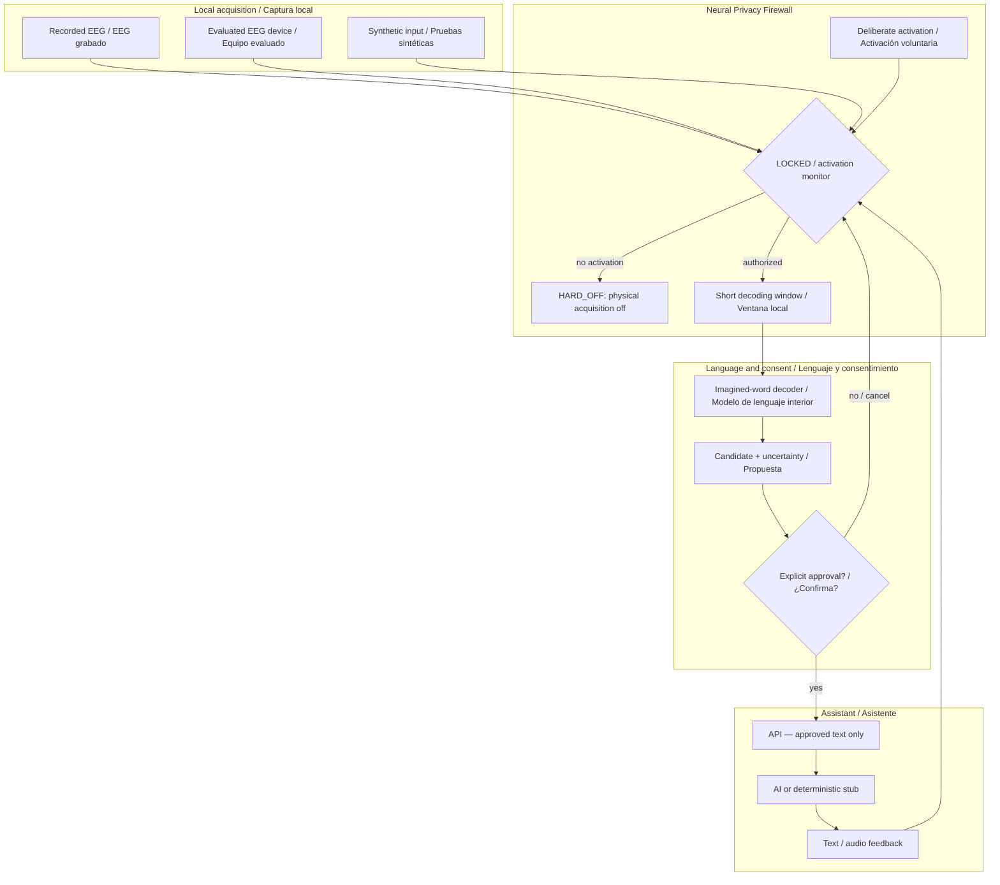

# NeuroLink AI — inner speech + privacy / lenguaje interior y privacidad

**Proposed architecture only.** No validated EEG intent detection, inner-speech transcription or patient-ready circuitry is claimed.

**Interpretation:** HARD_OFF and a software LOCKED state are different. When a neural keyword detector is enabled, minimal signal acquisition is necessary even while language decoding is locked. OFF in the diagram represents intentionally disabled acquisition, not a state that a running wake detector can magically enter and still recognize thought.

The [firewall state machine](neural-privacy-firewall.md) has the authoritative behavior. The four-word dataset [Nieto2022](../docs/research/inner-speech-datasets.md) does **not** establish communicative intent; it only supports constrained content research.
