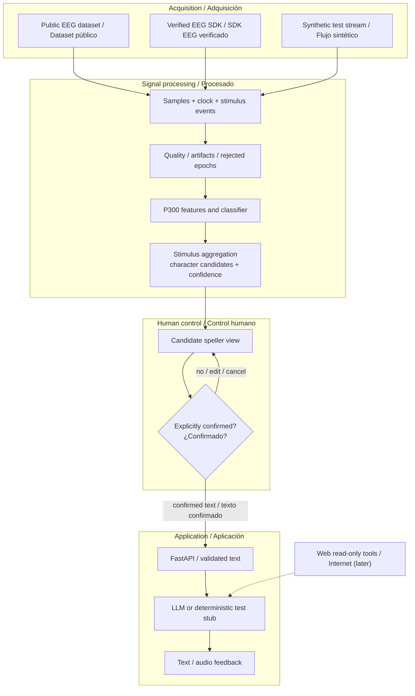

# EEG-to-AI pipeline / Arquitectura de software

**Type:** CONCEPTUAL DATAFLOW. No decoder, trained model or measured accuracy is implied.

## Invariants / Invariantes

- Every experimental result has a **source mode:** recorded EEG, live EEG or synthetic.
- Fit preprocessing on training data only; keep independent session/test partitions.
- `P300 target/non-target` metrics are not character-level spelling metrics.
- User corrections and LLM autocomplete are **not decoded neural data**.
- Confidence and abstention are shown to the user; false positives must never trigger web actions.
- Use versioned protocol metadata and an audit record for signal → selection → confirmation.

[Phase 1](../docs/technical/phase-1-eeg-to-text.md) · [Experimental protocol](../docs/technical/research-protocol.md).
