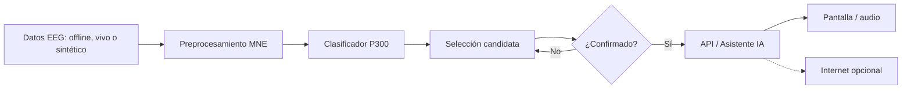
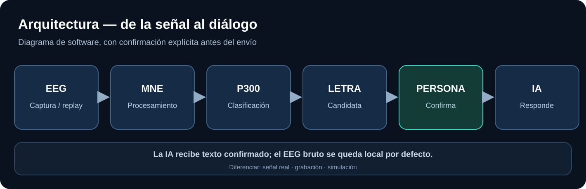

# Arquitectura de software — fuente editable

**Importante:** un clasificador de eventos P300 no se convierte automáticamente en decodificador de caracteres. Se necesita la estructura del paradigma y agregación de estímulos.
