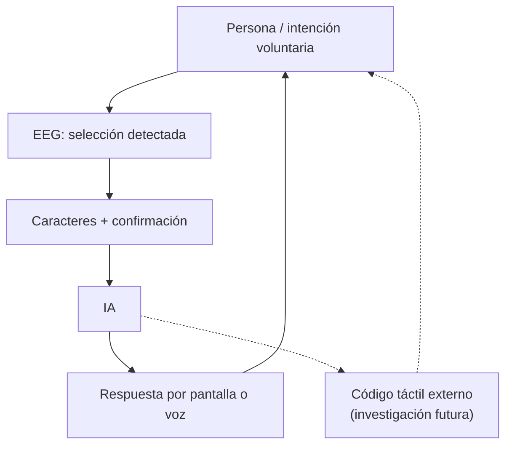

# Ciclo de comunicación bidireccional — fuente editable

Esta **bidireccionalidad funcional** utiliza sentidos naturales. No representa envío directo de conocimiento a neuronas.

[Conceptos de la fase 2](../docs/technical/phase-2-bidirectional.md).
