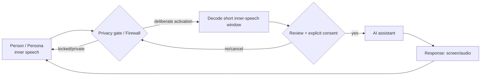

# Private by default: inner-speech communication loop

**Conceptual; no functioning mental activation system is claimed.** A powered-on keyword monitor still reads limited local EEG while in software LOCKED mode. A physical disconnect is a separate and stronger boundary.

[Neural privacy state machine](neural-privacy-firewall.md).
