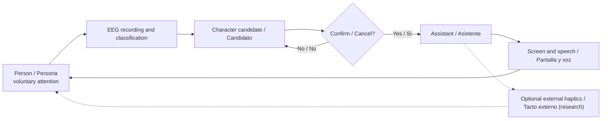

# Bidirectional communication / Comunicación bidireccional

**Type:** CONCEPTUAL CLOSED LOOP. The return path uses normal senses, not direct electrical stimulation of the brain.

**Scientific boundary:** direct intracortical stimulation can evoke some sensations in clinical research, but it has not been shown to deliver arbitrary semantic answers from an AI. We will not prototype neural stimulation in this independent repository.

[Phase 2 scientific details](../docs/technical/phase-2-bidirectional.md).
