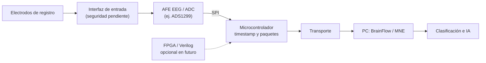
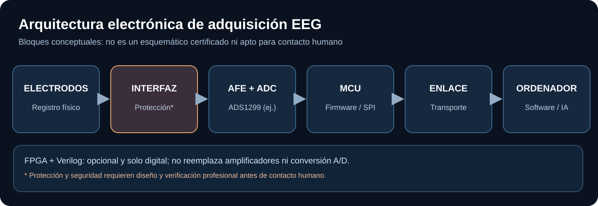

# Bloques de hardware — fuente editable

**No es un esquema eléctrico para construir ni conectar al cuerpo.** Las funciones de aislamiento, protección y alimentación requieren revisión profesional.

[Detalles de arquitectura física](../hardware/architecture.md).
