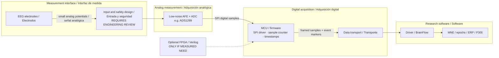

# EEG acquisition chain / Cadena de adquisición EEG

**Type:** CONCEPTUAL ENGINEERING BLOCK DIAGRAM — not a circuit schematic, electrical safety approval, or evidence that NeuroLink AI has built this hardware.

## Interface table / Tabla de interfaces

| Boundary / Límite | Signal / Señal | Engineering requirement / Requisito |
| --- | --- | --- |
| Electrode → AFE | Low-level analog potential | Noise, impedance, protection, safety assessment |
| AFE/ADC → MCU | SPI serial samples | Correct word format, DRDY timing, sample count |
| MCU → host | Framed digital data | Timestamps, loss detection, packet integrity |
| Host → decoder | EEG + stimulus markers | Time alignment, calibration, preprocessing log |
| Decoder → assistant | Confirmed characters only | Explicit user approval, no raw EEG to LLM by default |

**Notes / Notas:** ADS1299 is a *reference component*, not an approved NeuroLink AI schematic. Real electrodes may only be connected using a system whose full safety has been professionally evaluated for its intended use. See [OpenBCI hardware designs](https://docs.openbci.com/ForDevelopers/HardwareDevelopment/) and [NeuroLink safety requirements](../hardware/safety-review.md).

[Real hardware photographs / Fotografías reales](../assets/real/README.md) · [Electronics documentation](../hardware/README.md).
