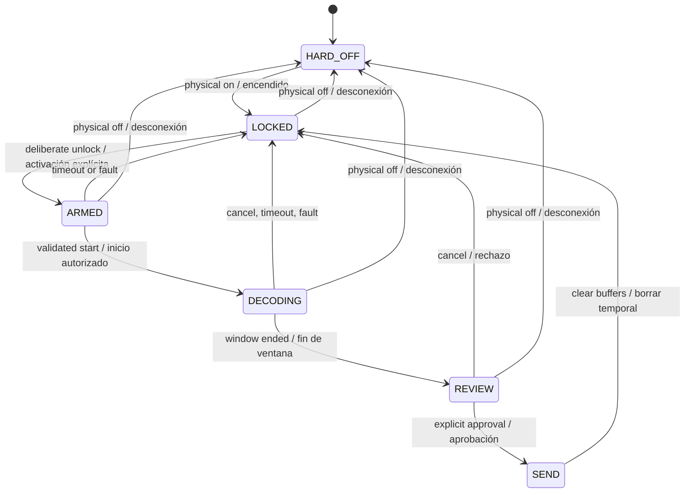

# Neural Privacy Firewall — state machine / máquina de estados

**Type:** proposed design, **NOT** a demonstrated EEG intent recognizer.  
**Control principle:** *inner speech is not consent / hablar mentalmente no implica consentimiento*.

| State | Language decoding | Data allowed to leave device |
| --- | --- | --- |
| HARD_OFF | Off | None |
| LOCKED | Off; minimal on-device wake monitoring **only if enabled** | None |
| ARMED / DECODING | Local, bounded window | None |
| REVIEW | Candidate displayed locally | None |
| SEND | Complete | **Only explicitly confirmed text** |

**Important:** mental keyword recognition would itself require on-device EEG acquisition. A true hardware-off state is distinct from a software lock. A keyword gate's effectiveness must be established experimentally and cannot be inferred from implanted-device trials.

[English specification](../docs/en/technical/neural-privacy-firewall.md) · [Español](../docs/technical/neural-privacy-firewall.md).
