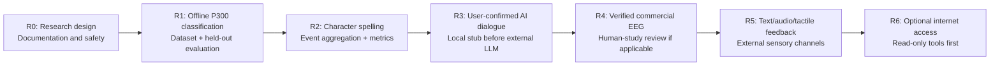

# Research phases / Fases de investigación

**Type:** PLANNED ROADMAP. These are milestones, not completed experimental outcomes.

| Track / Línea | First deliverable / Primera entrega | Gate / Criterio |
| --- | --- | --- |
| BCI algorithm | Offline ERP classifier | Reproducible, no test leakage |
| Spelling | Characters from actual paradigm events | Character-level accuracy, false commands |
| Human-computer interface | Confirm → send → receive | No action from unconfirmed input |
| Hardware | Architecture and digital simulation | Bench tests, then independent safety evaluation |
| Feedback | Text, audio, then external tactility | Comprehension and latency measured |
| Internet | Explicitly authorised retrieval | Controlled privileges, logged confirmation |

**Direct brain stimulation and semantic download are not milestones for home experimentation.** They remain literature-review / regulated clinical research topics only.

[Roadmap](../docs/research/roadmap.md) · [Safety](../docs/technical/safety-privacy.md).
