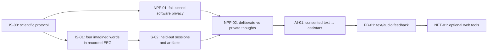

# NeuroLink AI — planned research milestones / hitos de investigación

| Track | Priority | Limitation |
| --- | --- | --- |
| Inner speech | Core | No free-form scalp EEG transcript demonstrated |
| Neural privacy firewall | Core | Intent gating requires a separate dataset and evaluation |
| Physical privacy switch | Hardware investigation | Requires professional electronic safety review |
| Feedback | After controlled decoding | Display and voice, not neural knowledge upload |
| Internet | Optional | Only approved text, no raw EEG |

**No milestone is automatically completed by the existence of this diagram.**

[Roadmap ES](../docs/research/roadmap.md) · [Roadmap EN](../docs/en/research/roadmap.md).
