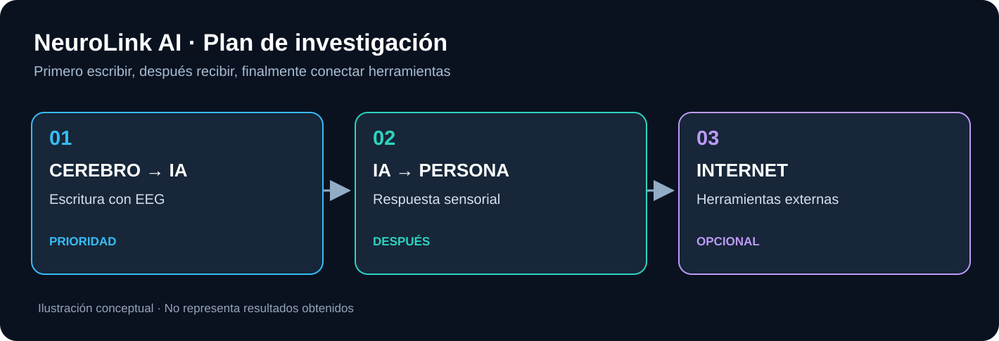

# Investigación, evidencia y planificación

Aquí se documenta **por qué investigamos, qué se sabe realmente y cómo avanzaremos**. La implementación de software queda en `docs/technical/`; la electrónica en `hardware/`.

- [Visión y objetivos](vision.md)
- [Estado de la ciencia](state-of-the-science.md)
- [Referencias y datasets](references.md)
- [Hoja de ruta](roadmap.md)
- [Decisiones y preguntas abiertas](decisions.md)

Los trabajos invasivos y la estimulación neuronal directa se estudian como referencias científicas: no se presentarán como tecnología doméstica ni como una capacidad conseguida por el proyecto.
