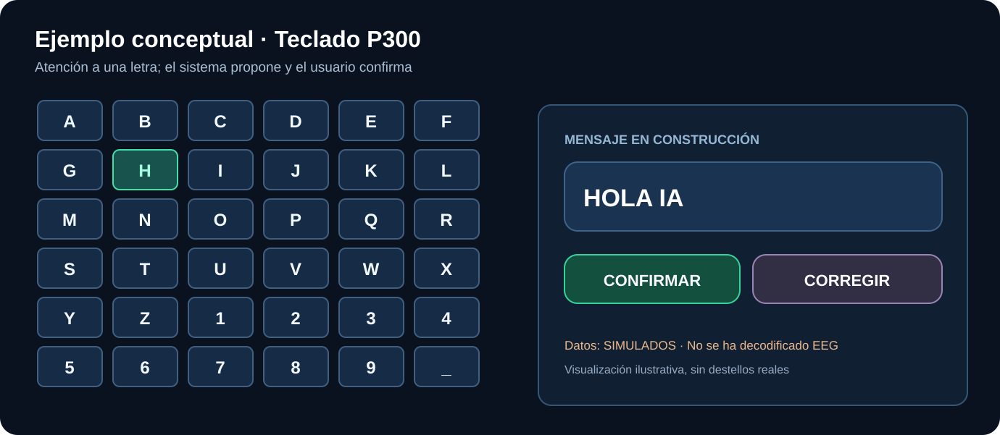

# La idea de NeuroLink AI

Queremos desarrollar una forma de comunicarnos con una inteligencia artificial mediante **actividad cerebral voluntaria**.

Piensa en escribir «HOLA IA» sin usar los dedos. Una pantalla podría mostrar letras y el sistema buscaría señales EEG relacionadas con la letra a la que estás prestando atención.

**Primero aprenderemos a seleccionar letras.** Eso ya es diferente de leer cualquier pensamiento: no sabemos convertir libremente en texto todas las frases que alguien imagina.

Después la IA respondería con texto o voz. También investigaremos si códigos táctiles externos podrían representar respuestas sencillas. Recibir información compleja mediante estimulación neuronal directa no es algo resuelto y no forma parte de experimentos caseros.

¿Y el acceso a Internet? Es una extensión posterior del software, no el desafío fundamental.

[Las tres fases](02-las-fases.md) · [Ejemplo de conversación](../../examples/conversacion.md).
