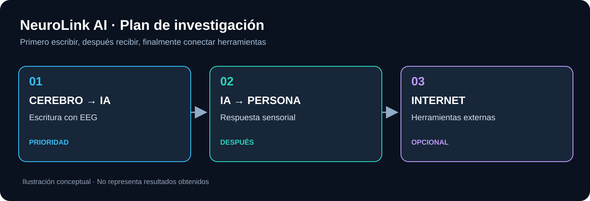

# Tres fases, por orden

## 1. Escribir a la IA

La prioridad será investigar métodos EEG como **P300**, que permiten seleccionar letras en un escenario controlado. El sistema debe reconocer señales, proponer caracteres y permitir confirmación y corrección.

## 2. Recibir las respuestas

Primero pantalla y audio. Después experimentaremos, si es útil, con señales táctiles externas como vibraciones para representar mensajes cortos. Los implantes de estimulación cerebral pertenecen a la investigación clínica, no a este prototipo.

## 3. Consultar Internet

La IA podrá utilizar herramientas de consulta para responder, con permisos y confirmación del usuario. Esta fase depende de las anteriores, pero no es nuestro objetivo científico principal.

**En todas las etapas distinguiremos simulaciones, EEG real registrado y EEG en vivo.**

[Más detalle técnico](../technical/README.md) · [Hoja de ruta](../research/roadmap.md).
