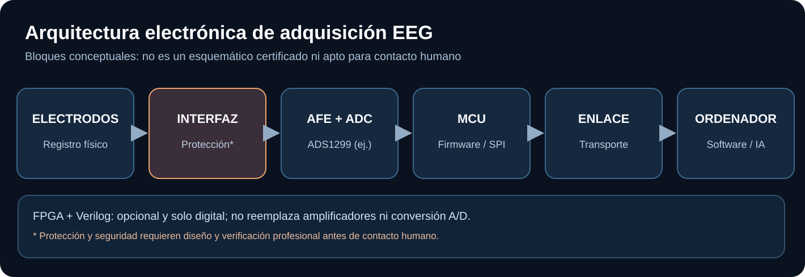

# ¿Por qué hacen falta circuitos electrónicos?

Para «escuchar» la actividad cerebral necesitamos transformar señales eléctricas diminutas en números que un ordenador pueda procesar.

## ¿Qué componentes aparecen?

1. **Electrodos:** captan diferencias de potencial en la superficie de la cabeza.
2. **Electrónica analógica especializada:** acondiciona señales muy débiles para poder medirlas.
3. **Convertidor analógico-digital (ADC):** convierte la medición en números.
4. **Microcontrolador:** organiza los datos y los envía al ordenador.
5. **Software e IA:** analizan patrones de selección y muestran letras.

Un chip conocido en este campo es el **ADS1299**, que integra varias funciones de adquisición. Hay placas de investigación como OpenBCI Cyton que lo utilizan.

## ¿Usaremos Verilog?

**Tal vez más adelante.** Verilog es un lenguaje para describir circuitos digitales, útil en FPGA. No puede reemplazar los electrodos ni la electrónica analógica que recibe las señales. Para el prototipo inicial, un microcontrolador suele ser suficiente.

## Importante

Diseñar un circuito electrónico no significa que sea seguro conectarlo a una persona. Primero trabajaremos con datos públicos, simulaciones y pruebas de banco; cualquier hardware propio para contacto humano exigiría evaluación profesional de seguridad.

[Ejemplo ilustrado de electrónica](../../examples/cadena-electronica.md) · [Documentación de hardware](../../hardware/README.md).
