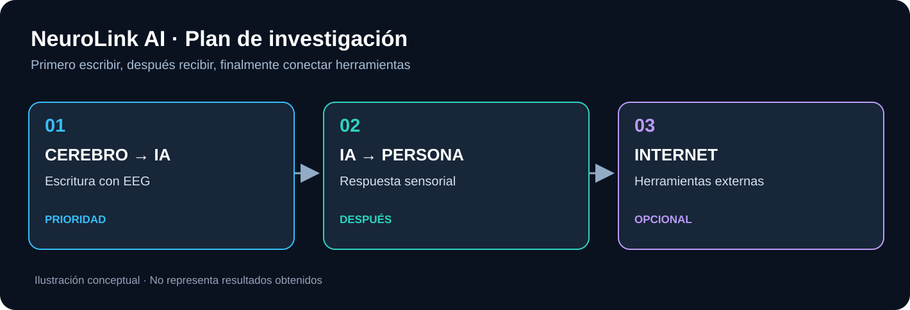

# NeuroLink AI en palabras sencillas

**¿Y si pudiéramos escribir a una IA sin mover las manos ni hablar?**

NeuroLink AI investiga esa posibilidad. Empezaremos por una pantalla con letras que el usuario selecciona prestando atención. Un sistema EEG registra actividad cerebral relacionada con esa atención, y un programa intenta reconocer la letra.

## Sigue esta ruta

- [**¿Qué queremos conseguir?**](01-el-proyecto.md) — explicación de la idea.
- [**Tres fases paso a paso**](02-las-fases.md) — cerebro → IA, respuesta, Internet.
- [**¿Necesitamos crear circuitos?**](03-la-electronica.md) — qué hace cada componente, sin Verilog ni fórmulas.
- [**Preguntas y limitaciones**](04-preguntas.md) — qué está demostrado y qué sigue siendo experimental.

Para verlo con imágenes: [ejemplos](../../examples/README.md).  
Para saber cómo se diseña: [electrónica](../../hardware/README.md) y [documentación técnica](../technical/README.md).
