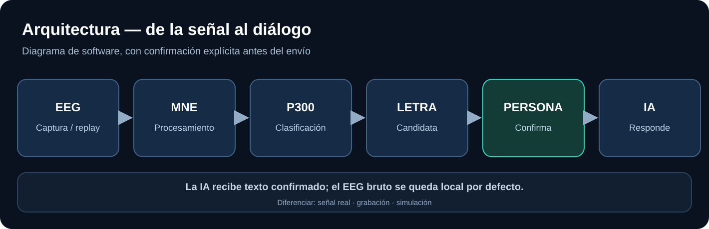

# Ingeniería de software y experimentación EEG

Esta carpeta reúne el **cómo funciona el software**: señales EEG, clasificación, protocolos, seguridad de la información e integración con una IA.

- [Arquitectura técnica de software](architecture.md)
- [Fase 1: P300 y texto](phase-1-eeg-to-text.md)
- [Fase 2: respuestas y bidireccionalidad](phase-2-bidirectional.md)
- [Fase 3: acceso a Internet](phase-3-internet.md)
- [Protocolo experimental](research-protocol.md)
- [Seguridad, ética y privacidad](safety-privacy.md)

**El diseño físico está separado:** [electrónica y hardware](../../hardware/README.md).  
**Los diagramas editables están separados:** [diagramas](../../diagrams/README.md).  
**La ciencia y la bibliografía están separadas:** [investigación](../research/README.md).

Estado: especificación, sin implementación validada.
