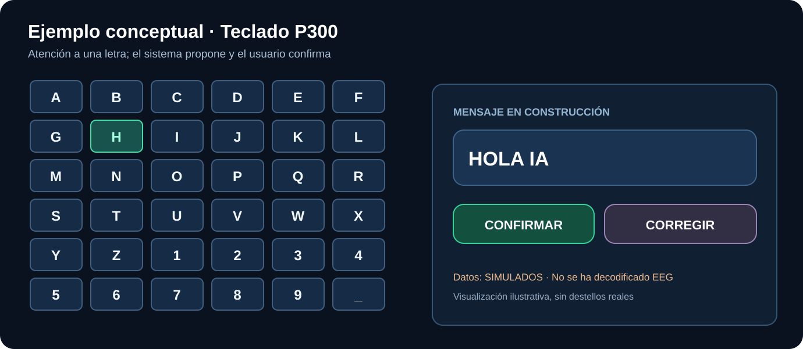

# Ejemplos explicados con imágenes

**Estas imágenes son ilustraciones originales**, no capturas de un sistema EEG funcional ni resultados de ensayos humanos.

| Ejemplo | Qué enseña |
| --- | --- |
| [Seleccionar letras con P300](teclado-p300.md) | Cómo se forma un mensaje sin usar teclado |
| [Enviar un mensaje a la IA](conversacion.md) | Confirmación de texto y respuesta |
| [La cadena electrónica](cadena-electronica.md) | Qué sucede antes de que el ordenador vea datos |

Para leer los conceptos sin tecnicismos: [explicación sencilla](../docs/simple/README.md).  
Para ver circuitos, especificaciones y HDL: [hardware](../hardware/README.md).
