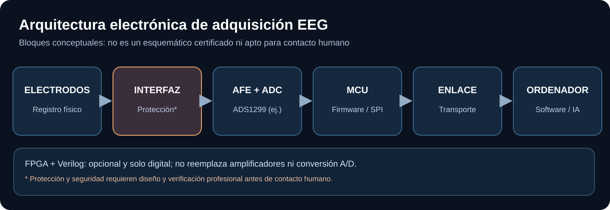

# Ejemplo 3 — Del electrodo al software

La electricidad medida por un EEG no llega directamente a la IA. Primero pasa por circuitos especializados que hacen que una señal analógica pueda representarse en números.

1. **Captura:** electrodos (en un sistema comercial apropiado para su finalidad).
2. **AFE y ADC:** recepción de biopotenciales y conversión a muestras digitales.
3. **Firmware:** gestión de muestras y marcadores temporales.
4. **Transporte:** comunicación al ordenador.
5. **Software:** procesamiento de señales y clasificación.

**Verilog entra solo en la parte digital** y es opcional. No reemplaza los circuitos analógicos de entrada.

La imagen es una arquitectura conceptual, **no un circuito apto para fabricar y conectar a una persona**.

[Diseño de referencia](../hardware/reference-designs.md) · [Seguridad electrónica](../hardware/safety-review.md).
