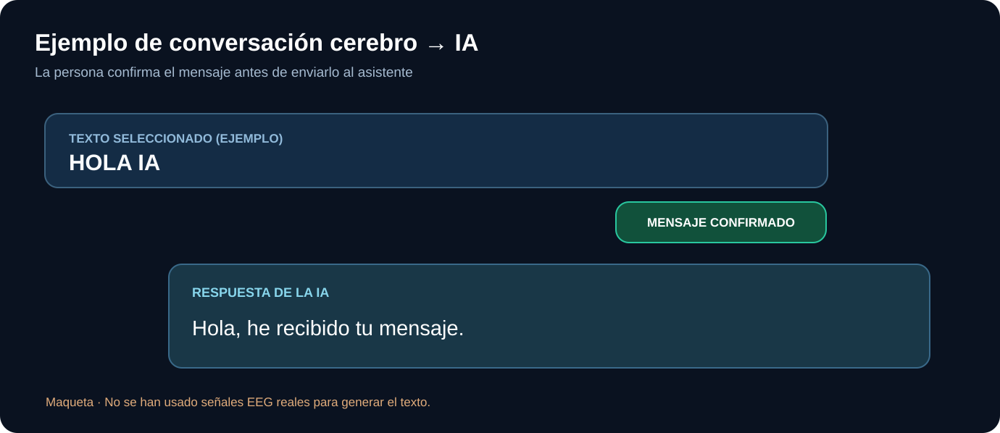

# Ejemplo 2 — Conversación con confirmación

En una demostración futura, el usuario seleccionaría caracteres con el teclado EEG. **Antes de enviar el mensaje, debe confirmarlo**. El asistente entonces devuelve texto o voz.

En el ejemplo:
- Entrada seleccionada: `HOLA IA`.
- Se muestra: «Mensaje confirmado».
- La IA responde: `Hola, he recibido tu mensaje.`

**No es una transcripción neuronal real**, sino una maqueta que ilustra el contrato de interacción. El origen de cada carácter debe ser rastreable: EEG grabado, EEG vivo o datos sintéticos.

[Arquitectura software](../docs/technical/architecture.md).
