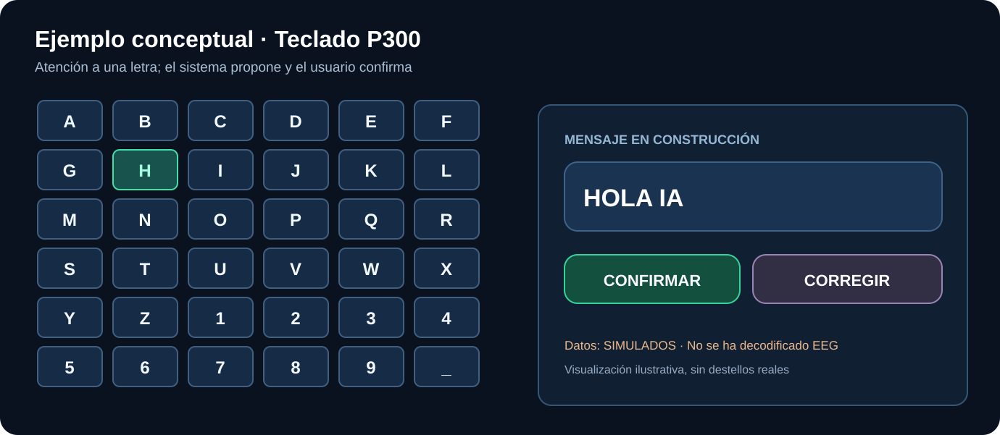

# Ejemplo 1 — Seleccionar una letra con P300

1. La persona mira una matriz de caracteres y concentra su atención en un objetivo.
2. El protocolo presenta estímulos y registra eventos sincronizados con EEG.
3. El clasificador puntúa la respuesta a cada evento.
4. El sistema agrega las puntuaciones conforme al patrón de estimulación.
5. Aparece una **letra candidata**, que puede corregirse o confirmarse.

En esta imagen la «H» es un ejemplo visual. **No se ha inferido a partir de señales EEG reales aquí.**

La visualización de destellos puede plantear riesgos de fotosensibilidad y requiere análisis de riesgos antes de estudios con participantes.

[Protocolo técnico P300](../docs/technical/phase-1-eeg-to-text.md) · [Investigación](../docs/research/README.md).
