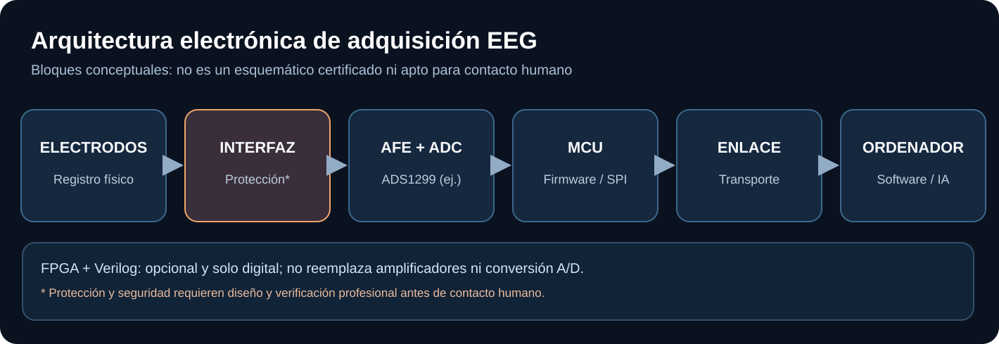

# Ingeniería electrónica de NeuroLink AI

Esta es la sección **exclusiva para circuitos, adquisición física, firmware y lógica digital**. Se mantiene separada de la explicación sencilla, el procesamiento software y las revisiones científicas.

## Qué debemos construir —y qué no—

La señal EEG es muy pequeña. Por eso se necesita una **cadena analógica de medida** antes de que la IA pueda recibir datos. El proceso es: electrodos → front-end analógico (AFE) → ADC → microcontrolador (SPI) → comunicación → procesamiento en ordenador.

**No necesitamos diseñar un procesador en Verilog para empezar.** Un AFE especializado como el ADS1299 puede digitalizar EEG y un microcontrolador puede transportar las muestras. FPGA/Verilog es opcional si las métricas futuras justifican más procesamiento digital.

## Navegación técnica

| Documento | Contenido |
| --- | --- |
| [Arquitectura física](architecture.md) | Bloques, flujos y decisiones de partición |
| [Front-end analógico y ADS1299](analog-front-end.md) | Qué hace el AFE, características y límites |
| [Firmware y transporte](digital-firmware.md) | SPI, marcas temporales, buffers y comunicaciones |
| [FPGA / Verilog / puertas lógicas](fpga-verilog.md) | Cuándo conviene HDL, ejemplo de simulación |
| [Fuentes y esquemas externos](reference-designs.md) | TI, OpenBCI y diseños existentes |
| [Seguridad y revisión](safety-review.md) | Evaluación humana y de hardware, normas pertinentes |
| [Decisiones de hardware](design-decisions.md) | Alternativas, prioridades y preguntas pendientes |
| [Ejemplo de módulo digital](hdl/sample_register.sv) | Verilog didáctico, **solo señales sintéticas** |
| [Testbench digital](hdl/tb_sample_register.sv) | Verificación simulada de flujo de muestras |

## Camino recomendado

1. **H0 — Documentación:** estudiar ADS1299, OpenBCI y estándares; definir requisitos medibles.
2. **H1 — Simulación:** datos sintéticos y testbenches; no electrodos humanos.
3. **H2 — Pruebas electrónicas de banco:** herramientas de laboratorio y fuentes de señal apropiadas, bajo supervisión cualificada.
4. **H3 — Prototipo de adquisición:** evaluar placa comercial o un diseño propio profesionalmente revisado.
5. **H4 — Contacto humano:** únicamente con aprobación ética/de seguridad, evaluación del sistema completo y equipo apto para ese uso.

> La presencia de un esquema, placa de evaluación o proyecto KiCad no implica que el equipo sea seguro para uso con personas. No conectar a una persona hardware experimental de biopotenciales sin evaluación profesional.

[Diagrama editable de hardware](../diagrams/hardware-signal-chain.md) · [Ejemplo visual](../examples/cadena-electronica.md)
